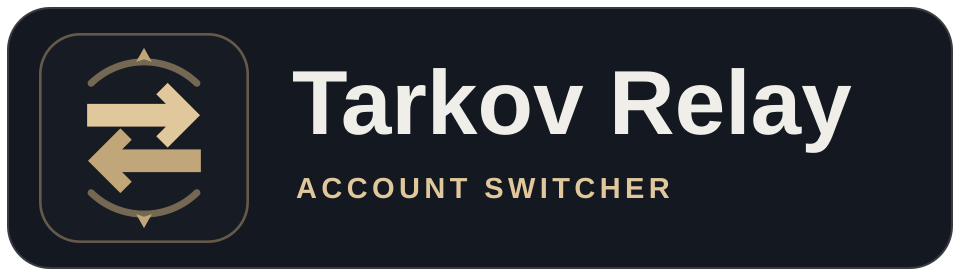
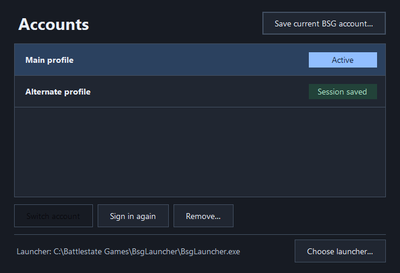

# Tarkov Relay — Account Switcher



Tarkov Relay is an independent Windows tray app for switching between your own saved Battlestate Games (BSG) Launcher accounts. It reuses saved sessions so you can switch in one click while they’re still valid.

[Download for Windows x64](https://github.com/tarkovtracker-org/tarkov-account-switcher/releases/latest)



## Features

- **One-click switching** from the system tray, with an **Active** badge when Relay can identify the current account. Switching to that account is disabled.
- **Nickname-only setup** with automatic detection of the standalone BSG Launcher.
- **Settings recovery** if a switch is interrupted. Unrelated launcher settings and game caches are preserved.
- **System themes** follow Windows light, dark, and contrast settings.
- **In-app updates** download and install new releases when you choose.

## Get started

1. Download and extract the Windows x64 ZIP. Run `TarkovAccountSwitcher.exe` as your regular Windows user. If Relay can’t find the launcher, select **Choose launcher** and point it to `BsgLauncher.exe`.
2. Sign in directly in the BSG Launcher and leave it open. In Relay, select **Save current BSG account**, enter a nickname, and save. Repeat for each account you use.
3. Pick a saved account from the tray, or select it in the window and click **Switch account**. Close the game first. Relay closes and reopens the launcher during the switch.

Relay is for the standalone BSG Launcher. For Steam-linked play, use Steam’s account flow.

## Security FAQ

### Do I enter my email, password, or verification code in Relay?

Relay only asks for a nickname. Enter sign-in details and verification codes directly in the BSG Launcher. When you save an account, Relay reads the launcher’s stored account identifier (usually your email) and reusable session from its local settings.

### Where are my saved sessions stored?

Relay stores account identifiers, sessions, and pending settings recovery in `%LOCALAPPDATA%\TarkovTracker\AccountSwitcher\vault.dat`. Windows Data Protection API (DPAPI) encrypts the vault for your Windows user. Software running as that user can still access it, so treat the vault and launcher settings as sensitive and keep them out of support posts.

### Does Relay send my account information anywhere?

Relay keeps account data on your PC. It contacts GitHub to check for releases and download updates. Update requests contain no saved nicknames, emails, or session tokens.

### Does it bypass email verification or two-factor authentication?

BSG still controls sign-in and can reject or expire a saved session. If that happens, click **Sign in again** and complete any prompts in the BSG Launcher.

### What does Remove do?

**Remove** deletes Relay’s saved copy. To sign out of BSG, use the launcher.

### What if a switch is interrupted?

Close the launcher and choose **Restore previous settings**. If the launcher has already changed its settings, choose **Keep current settings** to clear the recovery prompt.

### How are updates verified?

Relay checks for releases on startup. You can also select **Check for updates** in the window or tray. If you choose to install an update, Relay checks the download against the SHA-256 digest published by GitHub before installing it.

## Build and verify

Use Windows with the .NET SDK version in `global.json`.

```powershell
dotnet run --project src/TarkovAccountSwitcher
dotnet run --project tests/TarkovAccountSwitcher.Tests -c Release
dotnet publish src/TarkovAccountSwitcher -c Release -r win-x64 --self-contained false
```

The framework-dependent publish requires the .NET 10 Windows Desktop Runtime. Tests use synthetic sessions in temporary folders. To run a specific older build for recovery, launch it with `--skip-update`.

For releases, publish a self-contained `win-x64` build with `-p:Version=X.Y.Z` matching the tag `vX.Y.Z`. Package the publish folder as the top-level `TarkovAccountSwitcher` folder in `TarkovAccountSwitcher-vX.Y.Z-win-x64.zip`. The updater expects that asset name and GitHub's SHA-256 digest.
